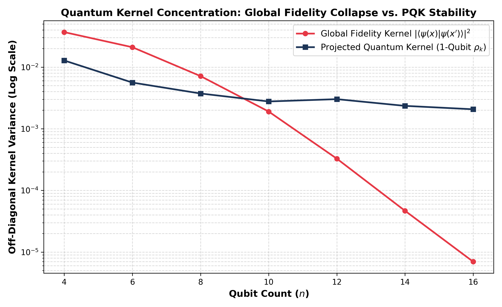

# NISQ-Resilient Projected Quantum Kernels (PQK) via Qiskit 1.x & IBM Hardware

A research implementation and hardware benchmark comparing **Projected Quantum Kernels (PQK)** against standard **Global Fidelity Quantum Kernels**, demonstrating the mitigation of exponential kernel concentration (Barren Plateaus) and evaluating noise transferability across simulated environments and utility-scale IBM quantum processors.

---

## Key Experimental Results

| Metric | Global Fidelity Kernel | PQK (Simulated Noise) | PQK (Physical QPU: `ibm_fez`) |
| :--- | :--- | :--- | :--- |
| **Off-Diagonal Variance ($n=16$)** | $6.98 \times 10^{-6}$ (collapsed) | $2.07 \times 10^{-3}$ (stable) | — |
| **Variance Retention vs Baseline** | Baseline ($1\times$) | **$\approx 300\times$ higher** | — |
| **Gram Matrix MAE vs. QPU** | $0.2409$ | **$0.0559$** | Ground Truth ($0.0000$) |
| **Shot Complexity** | $\mathcal{O}(2^{2n})$ | $\mathcal{O}(n/\epsilon^2)$ | $\mathcal{O}(n/\epsilon^2)$ |
| **Circuit Evaluations ($N$ samples)**| $\mathcal{O}(N^2)$ pairwise | $\mathcal{O}(N)$ individual | $\mathcal{O}(N)$ individual |

---

## Empirical Observations

1. **Mitigation of Exponential Concentration:**  
   Across qubit scaling from $n=4$ to $n=16$, the Global Fidelity Kernel exhibits an exponential variance collapse of over four orders of magnitude ($3.69 \times 10^{-2} \to 6.98 \times 10^{-6}$), flattening the Gram matrix into the identity matrix $\mathbf{I}$. In contrast, the Projected Quantum Kernel preserves a stable off-diagonal variance of $2.07 \times 10^{-3}$ at $n=16$, remaining expressive and well-conditioned for classical SVM classification.

2. **Accurate Hardware Noise Simulation:**  
   Evaluating the 1-qubit reduced density matrix expectation values $\big(\langle X_k \rangle, \langle Y_k \rangle, \langle Z_k \rangle\big)$ under local depolarizing ($1.5\%$ CNOT) and readout ($2.0\%$) errors achieved a **$0.0559$ Mean Absolute Error (MAE)** against the actual physical processor.

---

## Physical Hardware Execution Profile

* **QPU Target:** `ibm_fez` (Heron/Eagle 156-qubit architecture)
* **Optimization Level:** `3` (Automated physical qubit routing, SWAP reduction, and basis decomposition)
* **Native Basis Gates Executed:** `rz` (virtual-Z), `sx` ($\sqrt{X}$ microwave drive), `cz` (native controlled-Z entangler)
* **Transpiled Circuit Depth:** 25 layers
* **Verified IBM Job IDs:**
  * `dbi57eohoj4c73b5j4og` (`ibm_fez`, 156 qubits)
  * `dbi4ur8hoj4c73b5iqkg` (`ibm_marrakesh`, 156 qubits)

---

## Repository Structure

```text
D:.
│   
├───plot_results
│       plot.py                             # To plot the comparision graphs and heat maps.
│       hardware_gram_comparision.png       # Heat map plot between the 3 ways, Ideal Baseline (Standard Kernel) vs Simulated NISQ Noise (Projected Kernel) vs Physical IBM QPU (Projected Kernel)
|       kernel_concentration_benchmark.png  # Plot between the off-Diagonal Kernel Variance vs Qubit Count (4 to 16)
├───run_and_comparisions
│       benchmark_concentration.py          # Qubit Scaling Experiment (4 to 16) to see the difference between our proposed kernel vs the standard kernel
│       comparision_3_way.py                # Global Fedility vs Aer Simulation with Noise vs Physical QPU
│       Test_hardware.py                    # To check the token and connection to the IBM QPU is working or not (only 20 sec runtime)
│       token_saving.py                     # To save the token in your local qiskit environment
│       
├───src
    ├───circuits
    │       feature_map.py                  # Parameterized entangling circuits and 1-qubit Pauli observables   
    │           
    ├───data
    │      data_loader.py                   # Dynamic multi-qubit PCA data preperation
    │           
    ├───hardware
    │       ibm_executor.py                 # Authenticated Qiskit Runtime V2 hardware pipeline
    │           
    ├───kernels
    │       fidelity_kernel.py              # Baseline / Standard Global state fedility overlap
    │       projected_kernel.py             # Local expectation Extraction (Estimator V2) + RBF metric
    │           
    ├───models
    │       svm_classifier.py               # Scikit-learn precomputed SVM integration
    │           
    └───noise
           noise_models.py                  # Depolarizing and readout noise configuration
```

---

## Quickstart

### 1. Install Dependencies
```bash
pip install qiskit qiskit-aer qiskit-ibm-runtime scikit-learn scipy matplotlib
```

### 2. Run Local Benchmark
```bash
# Verify the difference between Standard and Projected Kernel upto 16 qubits
# NOTE: You can go upto 25 qubits, but it will take exponentially more time.
python run_and_comparisions/benchmark_concentration.py
```

### Run on Physical Quantum Hardware
```bash
# Save the token locally so that you won't need to use it everytime.
python run_and_comparisions/token_saving.py

# Verify if your able to use real IBM QPU
python run_and_comparisions/Test_hardware.py

# After verification run the comaprision file to see the difference between all the 3 types.
python run_and_comparisions/comparision_3_way.py
```

---

## Results and Visualizations



